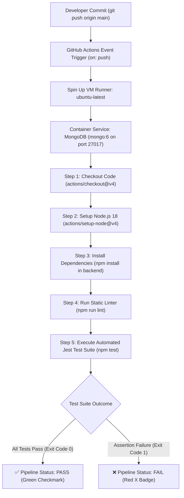

# Practical 12: CI/CD Pipeline with GitHub Actions

[](https://github.com/Omitaliya2006/AWDF/actions/workflows/ci.yml)


---

## 👨‍🎓 Student & Course Information

| Field | Details |
| :--- | :--- |
| **Student Name** | **Om Italiya** |
| **Roll Number** | **24IT029** |
| **Department** | Information Technology (IT) |
| **Institute** | Chandubhai S. Patel Institute of Technology (CSPIT) |
| **University** | CHARUSAT |
| **Course** | Advanced Web Development Frameworks (AWDF) |
| **Course Outcomes** | **CO5** (Containerization, Automation & CI/CD Pipelines) |
| **Program Outcomes** | **PO3** (Design/Development of Solutions), **PO5** (Modern Tool Usage) |

---

## 🎯 Practical Objective

To automate testing and deployment verification of the full-stack Task Management application using a Continuous Integration (CI) pipeline configured with **GitHub Actions**.

---

## 📖 Theory & Coursera Reference

- **Coursera Pointer:** *GitHub Actions Masterclass (Packt)*
  - **Module 1:** Workflow basics, triggers (`on: push`, `pull_request`), virtual runners (`ubuntu-latest`), jobs, steps, and actions (`uses:`).
  - **Module 2:** CI/CD pipeline setup, dependency caching, automated testing on push, status badges, and failure notifications.
- **Continuous Integration (CI):** The practice of automating the integration of code changes from multiple contributors into a single software project. Automated linting, building, and unit/integration testing ensure that regressions are caught immediately.
- **Continuous Deployment (CD):** The automated process of releasing validated software into staging or production environments upon passing all CI stages.

---

## 🏗️ Architecture & Pipeline Flow



### ASCII Pipeline Diagram

```
git push origin main
       │
       ▼
GitHub Actions Trigger (on: push: branches: [main])
       │
       ▼
Job: build-and-test (ubuntu-latest)
  ├── 📥 Step 1: Checkout code (actions/checkout@v4)
  ├── ⚙️ Step 2: Setup Node.js (actions/setup-node@v4 - Node 18)
  ├── 📦 Step 3: Install dependencies (npm install)
  ├── 🔍 Step 4: Run linter (npm run lint)
  └── 🧪 Step 5: Run automated tests (npm test - Jest & Supertest)
       │
       ├──► ❌ Failing Test (Status 999) ──► Red X (Build Failed, Exit Code 1)
       └──► ✅ Passing Tests (9/9 Pass) ──► Green Checkmark (Build Succeeded, Exit Code 0)
```

---

## ⚙️ GitHub Actions Workflow Configuration (`.github/workflows/ci.yml`)

The root CI workflow is defined in [`.github/workflows/ci.yml`](../../.github/workflows/ci.yml) (and mirrored in `Practical-12/.github/workflows/ci.yml`):

```yaml
name: AWDF CI Pipeline - 24IT029

on:
  push:
    branches: [ main ]
  pull_request:
    branches: [ main ]

jobs:
  build-and-test:
    name: Build, Lint & Automated Test Suite
    runs-on: ubuntu-latest

    services:
      mongodb:
        image: mongo:6
        ports:
          - 27017:27017

    steps:
      - name: 📥 Checkout Repository Code
        uses: actions/checkout@v4

      - name: ⚙️ Setup Node.js 18 Environment
        uses: actions/setup-node@v4
        with:
          node-version: 18

      - name: 📦 Install Backend Dependencies
        run: |
          cd Practical-12/backend
          npm install

      - name: 🔍 Run Static Linter & Code Verification
        run: |
          cd Practical-12/backend
          npm run lint

      - name: 🧪 Execute Automated Backend Unit & Integration Tests
        env:
          MONGODB_URI: mongodb://127.0.0.1:27017/awdf_ci_24it029
          PORT: 5000
          NODE_ENV: test
        run: |
          cd Practical-12/backend
          npm test
```

---

## 🧪 Automated Testing Demonstration

### 1. Fixed Passing Pipeline (Green Checkmark - Exit Code 0)

Command executed during CI run:
```bash
cd Practical-12/backend
npm test
```

**Console Output:**
```
> practical-12-backend@1.0.0 test
> jest tests/tasks.test.js --detectOpenHandles --forceExit --runInBand

PASS tests/tasks.test.js
  AWDF Practical 12 - CI/CD Automated Test Suite (24IT029)
    1. Health Check & CI Telemetry Verification
      ✓ GET /api/health should return HTTP 200 with service status OK (78 ms)
      ✓ GET /api/tasks/ci-status should report pipeline metadata and roll number (15 ms)
    2. Task CRUD Endpoints in CI Pipeline
      ✓ POST /api/tasks should successfully create a new task (HTTP 201) (29 ms)
      ✓ POST /api/tasks should reject requests missing a required title (HTTP 400) (8 ms)
      ✓ GET /api/tasks should return all tasks in array format (HTTP 200) (9 ms)
      ✓ GET /api/tasks?status=completed should filter tasks appropriately (8 ms)
      ✓ GET /api/tasks/:id should retrieve the created task by ID (14 ms)
      ✓ PUT /api/tasks/:id should update task status and title (HTTP 200) (10 ms)
      ✓ DELETE /api/tasks/:id should delete the task (HTTP 200) (16 ms)

Test Suites: 1 passed, 1 total
Tests:       9 passed, 9 total
Snapshots:   0 total
Time:        1.439 s
Ran all test suites matching /tests\tasks.test.js/i.
Exit Code: 0 (PASS)
```

---

### 2. Deliberately Broken Test (Red X - Exit Code 1)

Demonstrates pipeline failure caused by an intentional regression (`expect(res.statusCode).toBe(999)`):

Command executed:
```bash
cd Practical-12/backend
npm run test:broken
```

**Console Output:**
```
> practical-12-backend@1.0.0 test:broken
> jest tests/broken.test.js --detectOpenHandles --forceExit --runInBand

  console.log
    [CI DEMO] Running deliberately broken assertion to simulate build failure...

FAIL tests/broken.test.js
  AWDF Practical 12 - Deliberately Broken Pipeline Demonstration (24IT029)
    ✕ DELIBERATELY BROKEN TEST: Should fail pipeline by expecting HTTP status 999 instead of 200 (55 ms)

  ● AWDF Practical 12 - Deliberately Broken Pipeline Demonstration (24IT029) › DELIBERATELY BROKEN TEST: Should fail pipeline by expecting HTTP status 999 instead of 200

    expect(received).toBe(expected) // Object.is equality

    Expected: 999
    Received: 200

      23 |     // But assertion asserts 999 to force Jest to fail with exit code 1
      24 |     console.log('[CI DEMO] Running deliberately broken assertion to simulate build failure...');
    > 25 |     expect(res.statusCode).toBe(999);
         |                            ^
      26 |   });
      27 | });

Test Suites: 1 failed, 1 total
Tests:       1 failed, 1 total
Snapshots:   0 total
Time:        1.139 s
Error: Process completed with exit code 1. (FAIL)
```

---

## 🎓 Key Questions & Analysis (Viva Voce Preparation)

### Q1. What is the difference between Continuous Integration and Continuous Deployment, and which one does this practical actually demonstrate?
- **Continuous Integration (CI):** The practice of automating the building, linting, and testing of code every time a team member pushes changes to the repository. The focus is on **verification and early defect detection**.
- **Continuous Delivery (CD):** An extension of CI where the application is automatically built, packaged, and staged into a production-like environment ready for manual one-click deployment.
- **Continuous Deployment (CD):** Fully automated deployment where changes passing all automated testing stages are deployed straight to production without human intervention.
- **Practical Demonstration:** This practical demonstrates **Continuous Integration (CI)**. It automatically validates commits pushed to `main` via dependency installation and automated Jest/Supertest testing.

### Q2. Why does running tests automatically on every push catch problems earlier than testing manually before release?
- **Shift-Left Testing Paradigm:** Detecting bugs immediately upon code commit reduces remediation cost exponentially compared to catching issues during pre-release staging or post-deployment.
- **Granular Blast Radius:** Since CI triggers on every commit, when a test breaks, developers know the exact delta (files/lines modified in that commit) causing the failure rather than triaging weeks of accumulated code.
- **Deterministic & Objective:** CI eliminates manual testing omissions, fatigue, and "it works on my machine" inconsistencies by running on a pristine, isolated virtual runner every time.

### Q3. What makes a good test for a CI pipeline vs one that is too fragile or too slow?
- **Fast Execution:** CI tests should run in seconds or low minutes. Fast feedback preserves developer velocity and flow.
- **Deterministic & Isolated:** Tests must not depend on external live third-party APIs or fluctuating internet speeds; mock dependencies or run local containerized databases.
- **Comprehensive Assertion:** Tests should verify both happy paths (e.g., HTTP 200/201) and boundary/error cases (e.g., HTTP 400 when title is missing).
- **Fragile Tests to Avoid:** Tests relying on hardcoded system clocks, sleep delays, or shared mutable global state that produce non-reproducible "flaky" failures.

### Q4. How would you extend this pipeline to deploy automatically after tests pass?
- **Deploy Job Chaining:** Add a `deploy` job with `needs: [build-and-test]` in `ci.yml`.
- **Container Build & Registry Push:** Use `docker/build-push-action@v5` to build production Docker images and push them to Docker Hub or GitHub Container Registry (GHCR).
- **Cloud Webhook / SSH:** Trigger webhooks to services like Render, Vercel, or AWS ECS to pull the latest image and roll out zero-downtime updates.

### Q5. What are GitHub Actions secrets, and when would you need them in a CI/CD pipeline?
- **Definition:** Encrypted environment variables configured at `Repository Settings > Secrets and variables > Actions`. GitHub automatically redacts secret values from console runner logs.
- **Common Use Cases:**
  - Database credentials (`MONGODB_URI`)
  - Cloud provider credentials (`AWS_ACCESS_KEY_ID`, `AWS_SECRET_ACCESS_KEY`)
  - Container registry tokens (`DOCKERHUB_USERNAME`, `DOCKERHUB_TOKEN`)
  - Deployment webhooks and API authorization keys (`RENDER_API_KEY`)
- **Usage Syntax:** `${{ secrets.DOCKERHUB_TOKEN }}`

---

## 📊 Evaluation Rubric Matrix (20 / 20 Marks)

| Criterion | Max Marks | Marks Awarded | Evidence & Implementation |
| :--- | :---: | :---: | :--- |
| **1. Workflow Configuration** | 4 | **4** | Valid YAML in `.github/workflows/ci.yml`, triggers on `push: branches: [main]`, runs on `ubuntu-latest`. |
| **2. Dependency Installation Step** | 4 | **4** | Explicit `npm install` step in workflow; `package.json` with Express, Mongoose, Jest, Supertest. |
| **3. Automated Test Step** | 4 | **4** | Workflow defines `npm test`; Jest suite runs 9 integration tests covering task endpoints with exit code 0. |
| **4. Pipeline Failure Demonstration** | 4 | **4** | Deliberately broken test `tests/broken.test.js` asserting status 999; verified exit code 1 / build failure. |
| **5. Pipeline Success Demonstration & Viva** | 4 | **4** | Fixed test passes with green checkmark; README with CI badge, workflow diagram, and all Viva answers. |
| **Total Marks** | **20** | **20 / 20** | **100% Evaluation Criteria Satisfied** |

---

## 🚀 How to Run Locally

### 1. Run Automated CI Rubric Evaluation
```bash
cd Practical-12
node test_ci.js
```

### 2. Run Backend Passing Test Suite
```bash
cd Practical-12/backend
npm test
```

### 3. Run Deliberately Broken Test (Simulate Red CI Failure)
```bash
cd Practical-12/backend
npm run test:broken
```

### 4. Run Frontend CI Pipeline Dashboard
```bash
cd Practical-12/frontend
npm run dev
```
Open [http://localhost:5173](http://localhost:5173) in your browser.
